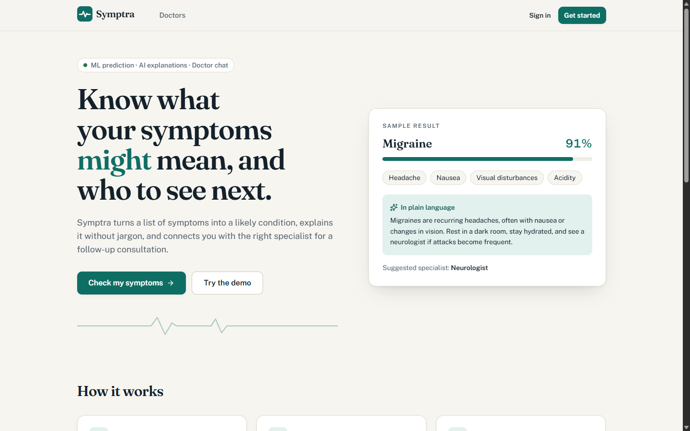
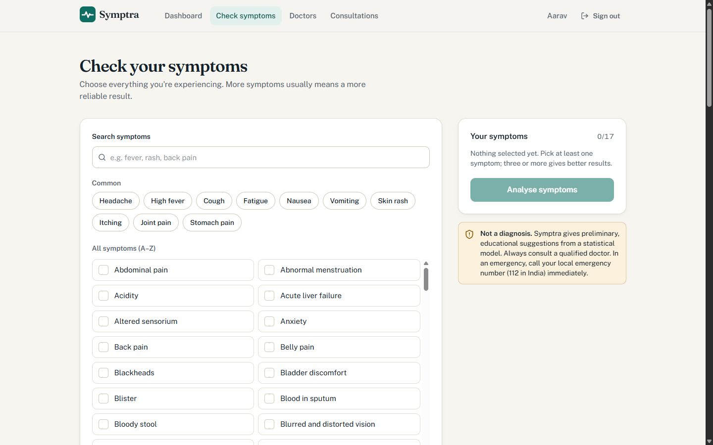
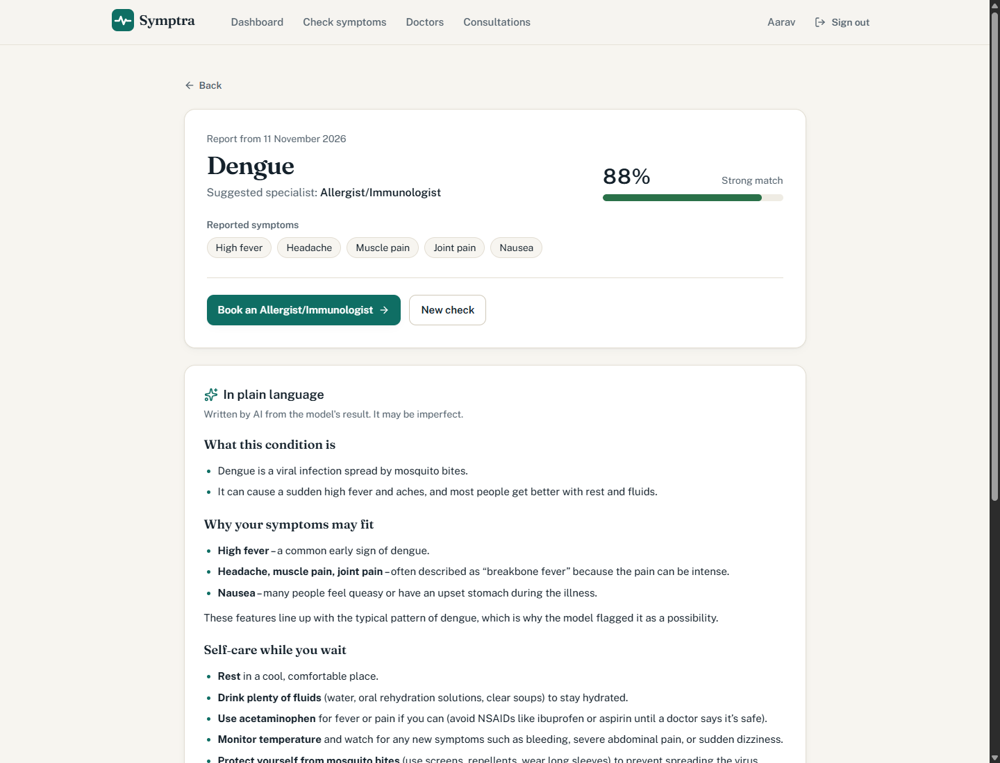
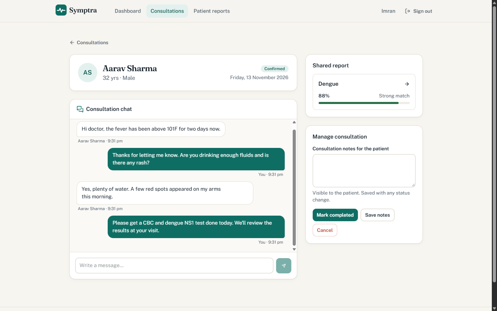
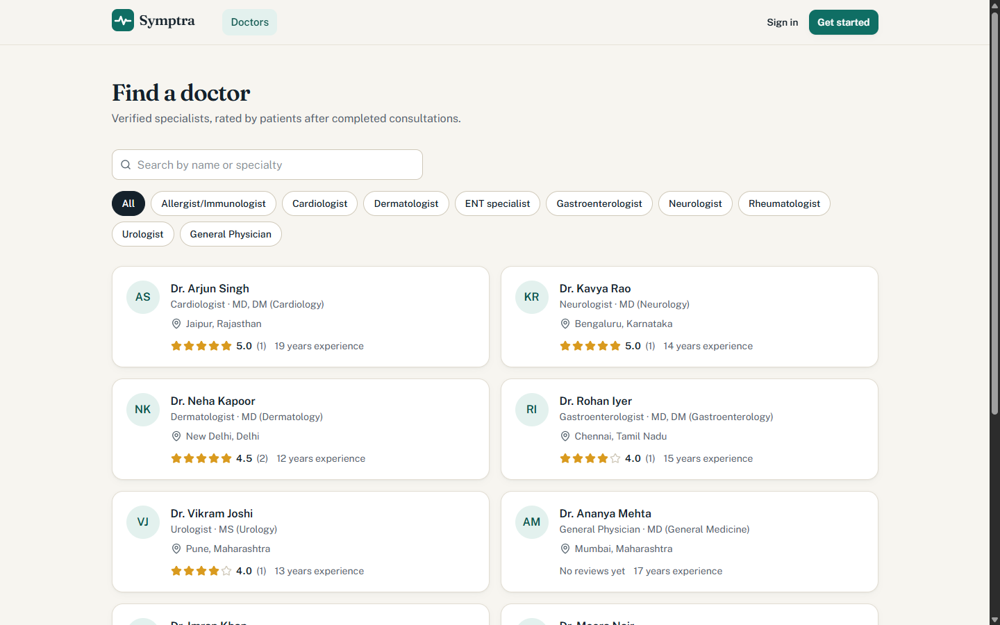
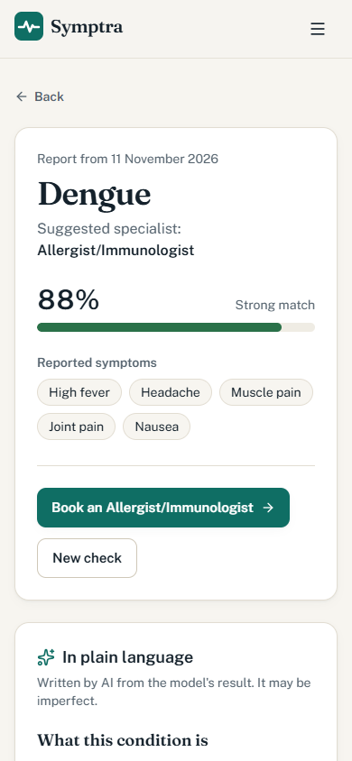
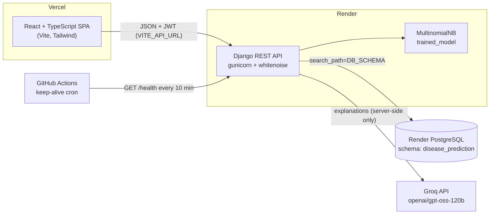

# Symptra: Disease Prediction from Symptoms

Symptra predicts a likely condition from a patient's symptoms with a trained Naive Bayes model. It explains the result in plain language with an LLM, then lets the patient book the right specialist and chat with them until the consultation closes.

> **Medical disclaimer:** Symptra is an educational portfolio project. Its output is a statistical suggestion, **not a diagnosis**, and it is no substitute for professional medical advice. In an emergency, call your local emergency number (112 in India).

| | URL |
| --- | --- |
| Live app (Vercel) | `https://<your-vercel-project>.vercel.app` |
| API (Render) | `https://<your-render-service>.onrender.com` (`/health`) |

Demo accounts are created by the seed. Both use the password `DemoPass#2024`:

- patient: `demo_patient`
- doctor: `dr_mehta`

The other seeded doctors (for example `dr_khan`) use the same password.

## Features

- **Symptom checker:** search 131 symptoms and get a likely condition from the bundled `trained_model` (scikit-learn MultinomialNB, 41 conditions). The result shows the model's confidence and the suggested specialist.
- **Plain-language AI explanation:** Groq (`openai/gpt-oss-120b`) explains what the condition is, why the symptoms fit, self-care, and red flags. It is called only from the backend. The text is cached on the report, and rate limits and outages are handled with friendly errors.
- **Specialist directory:** filter doctors by specialization or name. Ratings and reviews come from completed consultations.
- **Consultations:** patients request a date and can attach a report. Doctors confirm, add notes, complete or decline, and add clinical notes to the patient's report.
- **Consultation chat:** messages between patient and doctor (incremental polling), which become read-only once the consultation is closed.
- **Reviews and feedback:** patients rate completed consultations, and anyone signed in can send feedback (visible in Django admin).
- **Accounts:** patient and doctor sign-up, JWT auth, Argon2 password hashing, and profile editing.
- **Cold-start aware:** the UI shows a "waking up the server" notice when the free-tier API is slow to respond.

## Screenshots

| Landing | Symptom checker |
| --- | --- |
|  |  |
| **Result + AI explanation** | **Doctor consultation view** |
|  |  |
| **Doctor directory** | **Mobile (390 px)** |
|  |  |

Older design diagrams (ER, DFD, sequence) from the original version are in [`docs/diagrams/`](docs/diagrams/). They predate the model consolidation described below.

## Architecture



## Tech stack

| Layer | Tools |
| --- | --- |
| Frontend | React 19, TypeScript, Vite, Tailwind CSS v4, React Router, sonner (toasts), lucide icons |
| Backend | Django 5.2, Django REST Framework, SimpleJWT, django-cors-headers, whitenoise, gunicorn |
| ML / AI | scikit-learn MultinomialNB (bundled model), Groq SDK |
| Data | PostgreSQL (psycopg 3, dj-database-url), one schema per app |
| Quality | pytest + pytest-django, ruff, Vitest + Testing Library, ESLint, Prettier, GitHub Actions |

## Local setup

Prerequisites: Python 3.13, Node 20.19+ (CI uses 24), and a PostgreSQL instance.

```bash
# Backend (http://localhost:5120)
cd backend
python -m venv .venv
.venv/Scripts/activate            # Windows; use `source .venv/bin/activate` on macOS/Linux
pip install -r requirements-dev.txt
cp .env.example .env              # then fill in DATABASE_URL, GROQ_API_KEY ...
python manage.py migrate
python manage.py seed_demo
python manage.py runserver 5120

# Frontend (http://localhost:5210)
cd frontend
cp .env.example .env
npm install
npm run dev
```

Tests and checks:

```bash
cd backend && ruff check . && ruff format --check . && python -m pytest
cd frontend && npm run lint && npm run format:check && npm test && npm run build
```

## Environment variables

### Backend (`backend/.env`, Render)

| Variable | Required | Description |
| --- | --- | --- |
| `DATABASE_URL` | yes | PostgreSQL connection string |
| `DB_SCHEMA` | no (`disease_prediction`) | Postgres schema for this app's tables. It is created automatically and set as the `search_path`. |
| `JWT_SECRET` | yes in prod | Signs JWTs and acts as Django's `SECRET_KEY`. Render generates it. |
| `FRONTEND_URL` | yes | Allowed CORS origin(s), comma-separated, for example `https://symptra.vercel.app` |
| `GROQ_API_KEY` | for AI | Groq key used for explanations. Without it, the explanation endpoint returns a friendly 503. |
| `GROQ_TEXT_MODEL` | no | Defaults to `openai/gpt-oss-120b` |
| `DEBUG` | no (`false`) | Set to `true` only for local development |
| `ALLOWED_HOSTS` | no | Extra hostnames. `RENDER_EXTERNAL_HOSTNAME` is added automatically. |
| `SECURE_SSL_REDIRECT` | no (`true`) | Set to `false` only when testing production mode over plain HTTP |
| `THROTTLE_AUTH` / `THROTTLE_AI` | no | Rate limits (defaults `10/min` and `8/min`) |

### Frontend (`frontend/.env`, Vercel)

| Variable | Description |
| --- | --- |
| `VITE_API_URL` | Base URL of the API, without a trailing slash |

## Deployment

1. **Database:** create the single shared Render PostgreSQL instance once (free plan), or reuse it, and copy its *internal* connection string.
2. **API (Render Blueprint):** in Render, choose *New → Blueprint* and pick this repo. `render.yaml` declares the `disease-prediction-api` web service (`rootDir: backend`). Set `DATABASE_URL`, `GROQ_API_KEY` and `FRONTEND_URL` when prompted. The build installs dependencies, runs `collectstatic`, `migrate` and the idempotent `seed_demo`. It then starts gunicorn with health check `/health`.
3. **Frontend (Vercel):** import the repo, set **Root Directory** to `frontend` (Vite preset), and add `VITE_API_URL` pointing at the Render URL. `vercel.json` adds SPA rewrites and security headers.
4. **CORS:** set `FRONTEND_URL` on Render to the Vercel URL. Several URLs can be comma-separated, for example to add preview URLs.
5. **Keep-alive:** in GitHub, go to *Settings → Secrets and variables → Actions → Variables* and add `BACKEND_URL` (the Render URL). `.github/workflows/keep-alive.yml` pings `/health` every 10 minutes, which also runs `SELECT 1` against the database.
6. **Admin (optional):** run `python manage.py createsuperuser` from a Render shell, then open `/admin`.

## API overview

All endpoints return JSON. Errors use the shape `{"error": {"code", "message", "details?"}}`.

| Method | Path | Who |
| --- | --- | --- |
| GET | `/health` | public |
| POST | `/api/auth/register`, `/api/auth/login`, `/api/auth/refresh` | public, rate limited |
| GET/PATCH | `/api/auth/me` | signed in |
| GET | `/api/symptoms` | public |
| GET/POST | `/api/predictions`, GET `/api/predictions/:id` | patient creates; doctor sees shared reports |
| POST | `/api/predictions/:id/explain` | owner or treating doctor, rate limited |
| POST | `/api/predictions/:id/notes` | doctor |
| GET | `/api/doctors`, `/api/doctors/:id` | public |
| GET/POST | `/api/appointments`, GET/PATCH `/api/appointments/:id` | participants |
| POST | `/api/appointments/:id/review` | patient, after completion |
| GET/POST | `/api/appointments/:id/messages?after=<id>` | participants |
| POST | `/api/feedback` | signed in |

## Project structure

```
backend/
  disease_prediction/   settings (env-only), urls, JSON error handler, throttles
  accounts/             register / login / me (JWT)
  hospital/             Patient, Doctor, UserProfile + doctor directory
  records/              PredictionRecord, DoctorNote, Groq explanations (ai.py)
  appointments/         consultations, status workflow, reviews, chat endpoints
  chats/                Chat messages, Feedback
  main_app/             ML model wrapper (ml.py), symptoms endpoint, schema bootstrap, seed_demo
  tests/                pytest API + model tests
  trained_model         bundled scikit-learn model (joblib)
frontend/
  src/lib/              API client (JWT refresh, cold-start signal), auth, hooks, markdown
  src/components/       design-system primitives, layout, lists
  src/pages/            landing, auth, checker, results, doctors, consultations, profile
docs/                   screenshots, legacy diagrams
render.yaml             Render Blueprint
.github/workflows/      CI (lint, test, build) and keep-alive
```

## Design notes

- The original server-rendered Django templates were replaced by the React SPA. Every user flow from the old UI (patient and doctor sign-up, symptom check, doctor list, consultation, chat, rating, profile, feedback) exists in the new frontend. The admin feedback view is now Django admin.
- The original code had two parallel model sets (`main_app.patient/doctor/diseaseinfo/consultation/rating_review` and the newer `hospital`/`records`/`appointments`). They were consolidated into the newer set. A consultation is now an `Appointment`, chat messages belong to an appointment, and ratings live on the appointment. Migrations `chats.0003` and `main_app.0008` perform this.
- The trained model is unchanged. Readable display names fix typos in the training labels (for example "Osteoarthristis"). The original specialist mapping bug, which sent Rheumatology cases to "other", is fixed and covered by a test.
- The original disease-to-specialist table also sent several conditions to unrelated specialists (diabetes to a gastroenterologist, dengue and malaria to an allergist, hypothyroidism to ENT). Those now route to a General Physician, which is also the fallback for any unmapped disease.

## Author

Harsh Bathija · [github.com/HarshBathija-04](https://github.com/HarshBathija-04)
