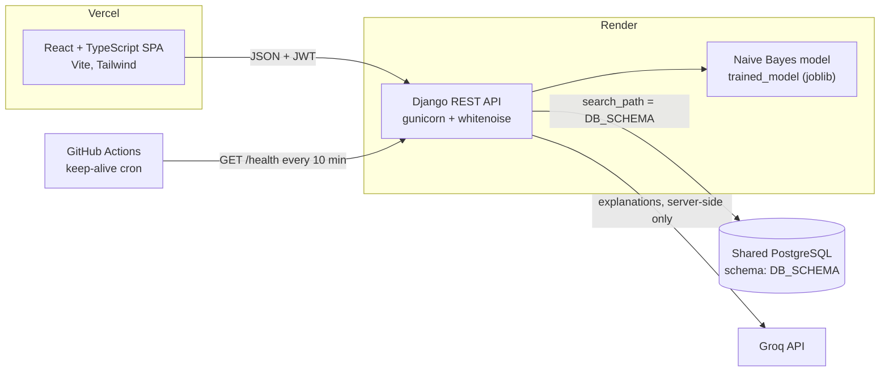

# Symptra

**Pick your symptoms, get a likely condition with a plain-language AI explanation, then book and chat with the right specialist.**

[](https://github.com/HarshBathija-04/Disease-Prediction/actions/workflows/ci.yml)


| | |
| --- | --- |
| **Live app** | `https://<your-vercel-project>.vercel.app` |
| **API** | `https://<your-render-service>.onrender.com/health` |
| **Demo logins** | patient `demo_patient` · doctor `dr_mehta` · password `DemoPass#2024` (or the one-click demo buttons on the sign-in page) |

> **Not medical advice.** Symptra is an educational portfolio project. It gives a statistical suggestion, not a diagnosis. In an emergency, call your local emergency number (112 in India).

## Features

- **Symptom checker:** search 131 symptoms. A bundled scikit-learn Naive Bayes model scores 41 conditions and returns a confidence and a suggested specialist.
- **AI explanation:** Groq writes what the condition is, why the symptoms fit, self-care, and red flags. It is called only from the server, cached on the report, and rate limited.
- **Specialist directory:** filter by specialization or name. Ratings come only from completed consultations.
- **Consultations:** patients book a date and attach a report. Doctors confirm, write notes, complete or decline.
- **Consultation chat:** patient and doctor message each other until the consultation closes, then the chat becomes read-only.
- **Two roles, one app:** patient and doctor dashboards, JWT auth with silent refresh, Argon2 password hashing.
- **Cold-start aware:** a "waking up the server" notice appears when the free-tier API is slow to answer.

## Screenshots

| Landing | Symptom checker |
| --- | --- |
|  |  |
| **Result and AI explanation** | **Doctor consultation view** |
|  |  |
| **Doctor directory** | **Mobile** |
|  |  |

## Architecture



Design diagrams from the original college version (ER, DFD, sequence) are kept in [`docs/diagrams/`](docs/diagrams/); they predate the current data model.

## Tech stack

| Layer | Tools |
| --- | --- |
| Frontend | React 19, TypeScript, Vite, Tailwind CSS v4, React Router, sonner, lucide-react |
| Backend | Django 5.2, Django REST Framework, SimpleJWT, django-cors-headers, whitenoise, gunicorn |
| ML / AI | scikit-learn MultinomialNB (bundled), Groq SDK |
| Data | PostgreSQL via psycopg 3 and dj-database-url |
| Quality | pytest + pytest-django, ruff, Vitest + Testing Library, ESLint, Prettier, GitHub Actions |

## Quick start

You need Python 3.13, Node 20.19 or newer, and a PostgreSQL database.

```bash
# API on http://localhost:5120
cd backend
python -m venv .venv
source .venv/bin/activate          # Windows: .venv\Scripts\activate
pip install -r requirements-dev.txt
cp .env.example .env               # set DATABASE_URL; GROQ_API_KEY is optional
python manage.py migrate           # creates the DB_SCHEMA schema on first connect
python manage.py seed_demo         # demo doctors, patients, reports and chats
python manage.py runserver 5120

# Web app on http://localhost:5210 (second terminal)
cd frontend
cp .env.example .env               # VITE_API_URL=http://localhost:5120
npm install
npm run dev
```

Without `GROQ_API_KEY` everything works except the AI explanation, which shows a friendly "not available" message.

Run the same checks as CI:

```bash
cd backend  && ruff check . && ruff format --check . && python -m pytest
cd frontend && npm run lint && npm run format:check && npm test && npm run build
```

## Environment variables

**Backend** (`backend/.env` locally, Render in production)

| Variable | Required | Default | Purpose |
| --- | --- | --- | --- |
| `DATABASE_URL` | yes | | PostgreSQL connection string |
| `DB_SCHEMA` | no | `disease_prediction` | Schema that holds this app's tables. Created automatically and used as `search_path`. |
| `JWT_SECRET` | in production | dev key when `DEBUG=true` | Signs JWTs and serves as Django's `SECRET_KEY` |
| `FRONTEND_URL` | yes | `http://localhost:5210` | Allowed CORS origins, comma-separated |
| `GROQ_API_KEY` | for AI | | Key for the explanation endpoint |
| `GROQ_TEXT_MODEL` | no | `openai/gpt-oss-120b` | Groq model used for explanations |
| `DEBUG` | no | `false` | `true` only for local development |
| `ALLOWED_HOSTS` | no | `localhost,127.0.0.1` | Extra hostnames. Render's hostname is added automatically. |
| `SECURE_SSL_REDIRECT` | no | `true` | Set `false` only to test production mode over plain HTTP |
| `THROTTLE_ANON` / `THROTTLE_USER` / `THROTTLE_AUTH` / `THROTTLE_AI` | no | `120/min`, `600/min`, `10/min`, `8/min` | Rate limits |

**Frontend** (`frontend/.env` locally, Vercel in production)

| Variable | Purpose |
| --- | --- |
| `VITE_API_URL` | API base URL, no trailing slash |

## Deploy

1. **Database:** reuse the one shared PostgreSQL instance (Render's free plan allows one). Copy its *internal* connection string. Each app keeps its tables in its own schema, so nothing collides.
2. **API on Render:** *New → Blueprint* and pick this repo. `render.yaml` creates the `disease-prediction-api` web service from `backend/` and sets `DB_SCHEMA=disease_prediction`. When prompted, set:
   - `DATABASE_URL`: the shared database's internal URL
   - `FRONTEND_URL`: your Vercel URL
   - `GROQ_API_KEY`: your Groq key

   `JWT_SECRET` is generated for you. Each build installs dependencies, runs `collectstatic`, `migrate` and the idempotent `seed_demo`, then gunicorn starts with the health check on `/health`.
3. **Web app on Vercel:** import the repo, set **Root Directory** to `frontend` (Vite preset), and add `VITE_API_URL` with the Render URL. `vercel.json` adds SPA rewrites and security headers.
4. **Keep-alive:** in GitHub, open *Settings → Secrets and variables → Actions → Variables* and add `BACKEND_URL` with the Render URL. `.github/workflows/keep-alive.yml` calls `/health` every 10 minutes, which also runs `SELECT 1` on the database, so the free web service stays awake.
5. **Admin (optional):** run `python manage.py createsuperuser` in a Render shell, then open `/admin` to read feedback and manage data.

## Project structure

```
backend/
  disease_prediction/   settings (env only), URLs, JSON error handler, throttles
  accounts/             register, login, refresh, me
  hospital/             Patient, Doctor, UserProfile, doctor directory
  records/              prediction reports, doctor notes, Groq client (ai.py)
  appointments/         booking, status workflow, reviews, chat endpoints
  chats/                chat messages, feedback
  main_app/             model wrapper (ml.py), symptoms endpoint, schema bootstrap, seed_demo
  tests/                API and model tests
  trained_model         bundled scikit-learn model
frontend/src/
  lib/                  API client (token refresh, cold-start signal), auth, hooks, markdown
  components/           UI primitives, layout, list rows
  pages/                one file per screen
render.yaml             Render Blueprint
.github/workflows/      CI and keep-alive
```

## API

Every response is JSON. Errors share one shape: `{"error": {"code", "message", "details"?}}`.

| Method | Path | Who |
| --- | --- | --- |
| GET | `/health` | public (also checks the database) |
| POST | `/api/auth/register`, `/api/auth/login`, `/api/auth/refresh` | public, 10/min |
| GET, PATCH | `/api/auth/me` | signed in |
| GET | `/api/symptoms`, `/api/doctors`, `/api/doctors/:id` | public |
| GET, POST | `/api/predictions`, GET `/api/predictions/:id` | patient creates; a doctor sees reports shared with them |
| POST | `/api/predictions/:id/explain` | owner or treating doctor, 8/min |
| POST | `/api/predictions/:id/notes` | doctor |
| GET, POST | `/api/appointments`, GET, PATCH `/api/appointments/:id` | the patient and doctor of that appointment |
| POST | `/api/appointments/:id/review` | patient, once, after completion |
| GET, POST | `/api/appointments/:id/messages?after=<id>` | the patient and doctor of that appointment |
| POST | `/api/feedback` | signed in |

## Engineering highlights

- **Schema per app on one database.** Several portfolio apps share one free PostgreSQL instance. Each sets `DB_SCHEMA`, the schema is created on first connection, and the connection `search_path` points at it, so migrations and tables stay isolated without extra databases. The value is checked against a strict identifier pattern before it reaches SQL.
- **Transaction-safe writes.** Sign-up creates the user, role and profile in one transaction, and a booking creates the appointment and links the shared report in one transaction, so a failure never leaves half a record. The demo seed also runs in a single transaction and is idempotent, so it runs on every deploy.
- **Server-side state machine for consultations.** Patients may only cancel. Doctors must confirm before completing. Closed consultations reject new messages, and each one accepts a single review. All of this is enforced in the API, not just the UI.
- **Object-level access by queryset.** Every list and detail view filters by the signed-in patient or doctor, so another user's report or chat returns 404 rather than 403 and leaks nothing.
- **LLM behind the backend.** The Groq key never reaches the browser. Explanations are cached on the report, throttled per user, and Groq rate limits or outages map to clear 429 or 503 errors.
- **Model kept honest.** The original model file is used unchanged. Training-label typos get readable display names, and a buggy legacy specialist mapping (Rheumatology sent to "other", diabetes to a gastroenterologist) was fixed and covered by tests.
- **Built for free-tier hosting.** A keep-alive workflow keeps the API and database warm, and the client shows a "waking up" notice instead of a frozen screen during cold starts.
- **Consistent errors.** One DRF exception handler turns every error into the same JSON envelope, which the frontend maps straight onto form fields.

## Author

Harsh Bathija · [github.com/HarshBathija-04](https://github.com/HarshBathija-04)
